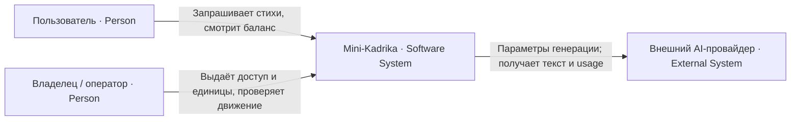
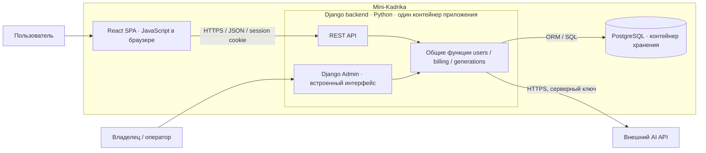
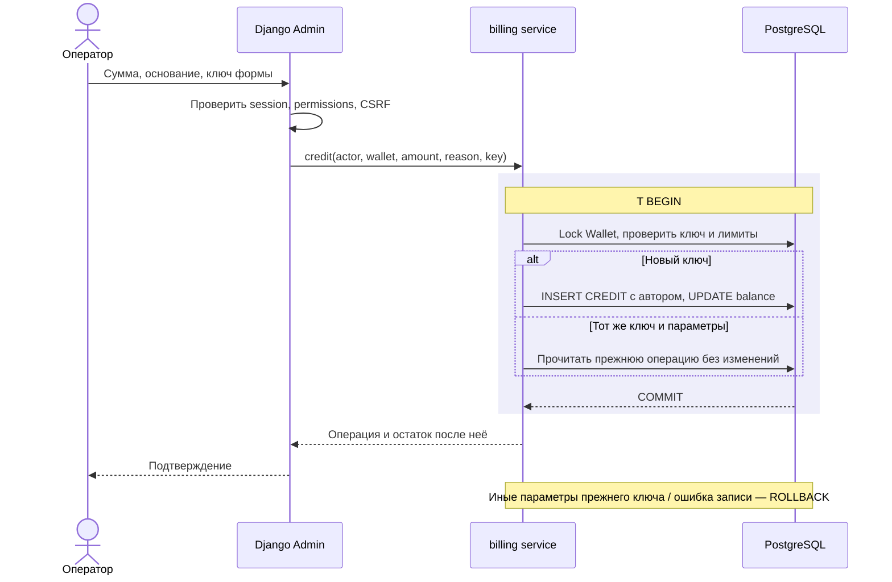

# Mini-Kadrika — архитектура

**Статус: Draft · 25.11.2026.** Исходный As-Is проверен по коду `c6bf957`, описание frontend актуализировано после удаления поллинга; To-Be — предложение под [требования и допущения](../product/requirements.md), не реализованный backend.

Документ организован по упрощённой [arc42](https://arc42.org/overview/). Подробности вынесены в связанные документы, без дублирования требований и схемы БД. [Оглавление комплекта](../README.md).

<a id="01-goals"></a>

## 1. Введение и цели

Пользователь создаёт стихотворения и видит расход своих внутренних единиц; оператор выдаёт доступ, начисляет единицы и контролирует операции. Приоритеты качества: корректный учёт, разделение данных пользователей и проверяемый результат.

Текущий результат — локальный frontend-прототип. Django, PostgreSQL и реальный AI относятся к проектируемому MVP. Границы, роли и требования FR/NFR: [requirements.md](../product/requirements.md). Операторские сценарии и аналитика: [mvp-proposal.md](../product/mvp-proposal.md).

<a id="02-constraints"></a>

## 2. Ограничения

Backend по исходному заданию должен быть на Python. Для следующего этапа выбраны Django, его админка и PostgreSQL; это проектные решения. Первая AI-интеграция синхронная, через OpenAI-совместимый API одного провайдера, без очереди. Реальные платежи и самостоятельная регистрация исключены из предлагаемого MVP.

Задание ограничивает разработку сутками; подробный план и объём сдачи ещё предстоит определить после обратной связи по прототипу. Числовые требования к нагрузке, тайм-аутам, бюджету и восстановлению остаются открытыми. См. [Q-01–Q-08](../product/requirements.md#вопросы-для-согласования).

В локальном прототипе данные хранятся в браузере, предназначены для одной вкладки и не обеспечивают серверную безопасность. [Ограничения прототипа](../prototype/prototype-limitations.md).

<a id="03-context"></a>

## 3. Контекст и границы системы



<a id="04-strategy"></a>

## 4. Стратегия решения

Модульный монолит: React SPA → REST API Django → PostgreSQL; Django обращается к одному внешнему AI-провайдеру. React отвечает за форму, отображение и кэш; Django — за авторизацию, валидацию, права, цену, финансовые инварианты и вызов AI. Браузер не передаёт доверенные `userId`, цену или остаток для изменения данных.

| Технология | Причина и граница |
| --- | --- |
| React + TypeScript | Сохранить имеющийся пользовательский интерфейс и `Api`; подключение требует доработок, перечисленных ниже. |
| Django, Django REST Framework | Django ORM, сессии, permissions, миграции; DRF предлагается для сериализации и REST, как в предложении MVP. Без собственного слоя универсальных репозиториев. |
| Django Admin | Внутренние формы и списки для доверенных операторов: создание аккаунта, начисление, фильтры и итоги. Часть Django, без отдельной SPA. Денежные действия вызывают общие сервисные функции. |
| PostgreSQL | Транзакции, блокировка кошелька, CHECK/FK/UNIQUE; схема — [модель данных](data-model.md). |
| Один AI HTTP API | Тонкий серверный адаптер нормализует текст, модель, usage и ошибки. OpenAI-совместимость из предложения MVP — гипотеза, которую проверяют на выбранном провайдере. |
| Docker Compose | Совместный запуск web и db, конфигурация, постоянный том, миграции. Версии закрепить при реализации. |

Django Admin рассчитан на внутреннее управление моделями и допускает собственные представления; это соответствует операторским сценариям проекта ([документация Django](https://docs.djangoproject.com/en/5.2/ref/contrib/admin/)).

Брокер, Redis, Celery, отдельный worker, микросервисы и WebSocket не нужны для предложенного синхронного сценария. Ограничение: AI занимает обслуживающий HTTP worker, после падения нет автоматического продолжения. Если согласованная нагрузка/длительность не укладывается в этот режим, решение пересматривается по Q-05/Q-06, а не молча дополняется очередью.

<a id="05-building-blocks"></a>

## 5. Структура системы

### Контейнеры To-Be



C4-контейнер SPA — приложение в браузере, не обязательный отдельный Docker-сервис. Admin показан внутри Django. Транспортный reverse proxy хостинга при необходимости обеспечивает TLS; это не дополнительный бизнес-сервис.

### Текущий frontend (As-Is)

| Участок | Файлы и ответственность |
| --- | --- |
| Модели / порт | [types.ts](../../src/api/types.ts): DTO `User`, `Wallet`, `WalletTransaction`, `Generation`, `AuthSession`, `GeneratePoemRequest`, `GenerationQuote`; один интерфейс `Api`. Нет самостоятельных Domain/Application-слоёв или нескольких доменных портов. |
| Локальный адаптер | [local.ts](../../src/api/local.ts), `createLocalApi`: вход, принадлежность данных, цена 10, валидация, дедупликация, списание, результат/возврат; один снимок сохраняется в конце. |
| Порт хранения и реализация | [storage.ts](../../src/api/storage.ts): `Storage = Pick<globalThis.Storage, "getItem" \| "setItem">`, `createStorage`; ключ `mini-kadrika:db`, схема v2, миграция v1, копии через `structuredClone`. Состояние в памяти меняется только после успешного `setItem`. |
| Заготовки | [demo-data.ts](../../src/api/demo-data.ts): аккаунты/начисления, `makePoem`. Выбор строф зависит от настроения и длины; тема отображается заголовком в UI, пожелания не интерпретируются. |
| REST-адаптер | [http.ts](../../src/api/http.ts), `createHttpApi`: fetch, JSON, `credentials: include`, декодеры DTO, перевод сетевых/HTTP-ошибок в `AppError`. Не использует LocalStorage и не имеет `demo`. |
| Composition Root | [main.tsx](../../src/main.tsx) создаёт `api = createApi(parseConfig(import.meta.env))` до React render. [api/index.ts](../../src/api/index.ts) выбирает реализацию; [Providers](../../src/app/providers/index.tsx) передаёт API через Context и настраивает TanStack Query. |
| Авторизация / навигация | [router](../../src/app/router/index.tsx): `Guard`, Layout и маршруты `/`, `/login`, `/generate`, `/history`, `/history/:id`, `/billing`. [LoginPage](../../src/pages/LoginPage.tsx): вход, очистка query-кэша и демо-сброс. |
| Генерации | [GenerationPages](../../src/pages/GenerationPages.tsx): форма, quote, UUID в React state, список/фильтр и детали. Поля заблокированы на время mutation. |
| Биллинг и сводка | [BillingPage](../../src/pages/BillingPage.tsx), [Dashboard](../../src/pages/Dashboard.tsx), [summary.ts](../../src/shared/utils/summary.ts): чтение баланса, операций и расчёт чистого расхода. |
| Данные и UI | [useData.ts](../../src/hooks/useData.ts): query keys с user ID, чтение генераций/кошелька/операций без таймеров; `useRefresh` в providers обновляет данные после генерации; [common.tsx](../../src/shared/components/common.tsx): статусы, копирование, таблицы и состояния ошибок. |

Зависимости: страницы → `useApi` / hooks → `Api`; composition root → фабрика → local либо http. Local → storage + demo-data; http → fetch + DTO + `AppError`. Context/hooks не проводят денежные операции. Это функциональная граница адаптеров, а не реализованная hexagonal-архитектура. Подробный существующий обзор — [frontend-architecture.md](../prototype/frontend-architecture.md).

Переключение: `VITE_DATA_SOURCE=local|http` (по умолчанию local), `VITE_API_BASE_URL` — HTTP(S) URL, по умолчанию `http://localhost:8000/api/v1`; после изменения конфигурации нужен перезапуск dev-сервера / новая сборка. См. [.env.example](../../.env.example). Неверный источник останавливает старт. Local выполняет генерацию сразу. Периодический опрос списка и деталей удалён; после генерации обновляются активные запросы, затем открывается результат. Новые страницы читают данные через query hooks. Вкладки не синхронизированы: storage держит собственный снимок, поэтому многовкладочное списание небезопасно.

### Модули backend (To-Be)

| Django app / участок | Ответственность |
| --- | --- |
| `users` | Минимальное расширение Django user, вход/выход, создание аккаунта вместе с кошельком, блокировка; стандартные sessions/groups/permissions. |
| `billing` | `Wallet`, `WalletTransaction`; общие функции начисления/списания/компенсации, запрет прямого изменения баланса/журнала через Admin. |
| `generations` | `Generation`, приём запроса, его дедупликация, AI-адаптер, финализация, чтение истории и management command восстановления. |
| Admin и отчёты | Регистрация моделей в соответствующих apps; агрегаты ORM поверх отфильтрованных списков, без отдельного приложения аналитики. |

Сервисные функции — обычные Python-функции вокруг ORM. `generations` координирует короткие транзакции и вызывает `billing`; API и Admin не дублируют правила. Использовать явные `transaction.atomic()`; не оборачивать целый запрос генерации в `ATOMIC_REQUESTS`, иначе внешний вызов окажется внутри транзакции. Основание — [управление транзакциями Django](https://docs.djangoproject.com/en/5.2/topics/db/transactions/). Блокировки и исходы операций определены в [BR-012](../product/business-rules.md).

Модель хранения, ERD, поля, ограничения и индексы: [data-model.md](data-model.md).

<a id="06-runtime"></a>

## 6. Сценарии выполнения

### Успешная генерация

```mermaid
sequenceDiagram
    actor U as Пользователь
    participant SPA as React SPA
    participant D as Django
    participant DB as PostgreSQL
    participant AI as AI API
    U->>SPA: Заполнить параметры и запустить
    SPA->>D: POST generations, requestId
    D->>D: Проверить сессию и параметры
    rect rgb(238, 238, 250)
        Note over D,DB: T1 BEGIN — короткая транзакция
        D->>DB: Заблокировать Wallet, проверить ключ и баланс
        D->>DB: INSERT PROCESSING + DEBIT, UPDATE balance
        DB-->>D: COMMIT T1
    end
    D->>AI: Генерация с конечным тайм-аутом
    Note over D,AI: Вне транзакции PostgreSQL
    AI-->>D: Текст, модель, usage
    rect rgb(238, 238, 250)
        Note over D,DB: T2 BEGIN
        D->>DB: Lock Wallet, Generation; PROCESSING и срок не истёк?
        D->>DB: Сохранить текст, usage, COMPLETED, completed_at
        DB-->>D: COMMIT T2
    end
    D-->>SPA: 200 Generation COMPLETED
    SPA-->>U: Результат; перечитать баланс и историю
```

### Неудача с возвратом

```mermaid
sequenceDiagram
    participant SPA as React SPA
    participant D as Django
    participant DB as PostgreSQL
    participant AI as AI API
    SPA->>D: POST generations, requestId
    rect rgb(238, 238, 250)
        Note over D,DB: T1 BEGIN
        D->>DB: Lock Wallet, проверить ключ/баланс
        D->>DB: PROCESSING + DEBIT + уменьшить balance
        DB-->>D: COMMIT T1
    end
    D->>AI: Вызов вне транзакции
    AI-->>D: Ошибка / тайм-аут / пустой ответ
    rect rgb(238, 238, 250)
        Note over D,DB: T2 BEGIN
        D->>DB: Lock Wallet, затем Generation; проверить PROCESSING и DEBIT
        D->>DB: INSERT единственный REFUND, увеличить balance, FAILED
        DB-->>D: COMMIT T2
    end
    D-->>SPA: 200 Generation FAILED, безопасная причина
    Note over D,DB: Если COMMIT не подтверждён — перечитать состояние, не обещать возврат
```

### Начисление через Django Admin



Конкурентные терминальные переходы и сбои сохранения разобраны в [бизнес-правилах](../product/business-rules.md); диаграммы показывают штатные ветви. Ни один внешний вызов не удерживает SQL-блокировку.

Текущий локальный путь генерации описан в [frontend-architecture.md](../prototype/frontend-architecture.md). Маршрут демонстрации: [demo-scenarios.md](../prototype/demo-scenarios.md).

<a id="07-deployment"></a>

## 7. Развёртывание

Запуск существующего frontend: [корневой README](../../README.md#как-запустить). Следующее описание относится к планируемому backend.

В репозитории сейчас нет backend, Dockerfile и Compose. Для MVP достаточно сервисов `web` (Django и собранная React SPA/static, production WSGI-сервер) и `db` (PostgreSQL с постоянным томом). React собирается на этапе Docker build; production `runserver` не используется. Способ отдачи static выбирается при реализации: небольшой static middleware либо уже имеющийся reverse proxy. TLS завершается средствами хостинга; отдельный proxy-контейнер нужен только при отсутствии этой возможности.

Предлагаемый порядок: задать серверное окружение из шаблона без секретов → `docker compose build` → поднять `db` и дождаться healthcheck → одноразово выполнить `migrate`, `collectstatic` и `createsuperuser` → поднять `web`. После миграций проверить `/auth/me`, вход Admin и тестовую генерацию. Приёмочный запуск использует управляемую заглушку AI, реальный провайдер проверяется отдельно. Имена команд и конфигурация будут добавлены при реализации, сейчас это не готовая инструкция запуска.

API-ключ, DB password, Django secret не помещать в `VITE_*`, образ, репозиторий или клиентские ответы. БД не публикуется наружу; сессии хранятся штатно в PostgreSQL. Копию БД хранить вне её рабочего тома и проверить восстановление. Management command восстановления запускается оператором в `web`, без постоянного worker/планировщика. Настройки тайм-аутов и регулярность проверки просроченных записей фиксируются после Q-05.

<a id="08-concepts"></a>

## 8. Общие правила и интерфейсы

Общие правила доступа, атомарности, идемпотентности, учёта токенов и восстановления: [business-rules.md](../product/business-rules.md). Они используются API, админкой и служебными командами. Ограничения хранения: [data-model.md](data-model.md).

[api-contracts.md](api-contracts.md) описывает предварительные формы текущего frontend. Ниже — необходимые изменения для Django; окончательная OpenAPI-спецификация пока не подготовлена.

### Предварительный API для Django

Это рабочий перечень для согласования, не окончательная OpenAPI-спецификация. Base path `/api/v1`, URL без завершающего `/`, как в адаптере. Не полагаться на redirect POST при несовпадении slash. В таблице: «есть» — метод HTTP-адаптера, не работающий сервер; «новый» — необходимая доработка.

| Метод / URL | Назначение, вход → выход To-Be | Авторизация / состояние |
| --- | --- | --- |
| `GET /auth/csrf` | Выдать CSRF cookie и `{csrfToken}` для последующих POST, включая login; после login токен обновить. | Публичный; новый, URL предварительный. |
| `POST /auth/login` | `{email,password}` → 200 `{user,createdAt}`, session cookie; 401 при неверных данных/неактивном аккаунте. | Без сессии, с CSRF; есть, DTO ответа требует изменения. |
| `POST /auth/logout` | Без тела → 204, инвалидировать сессию. | С CSRF; повторный logout допустим без активной сессии; есть. |
| `GET /auth/me` | → 200 `User` или `null`, если сессии нет/аккаунт неактивен. | Публичная проверка сессии; есть. |
| `GET /generations/quote` | → `{cost,balance,balanceAfter,canGenerate}`; только снимок, без резервирования. | Активный пользователь; есть. |
| `POST /generations` | `{requestId,topic,instructions,mood,stanzaCount}` → 200 `Generation` в `COMPLETED`/`FAILED` после синхронного исполнения. Повтор уже принятого ключа → 200 с текущей записью, в том числе `PROCESSING`, без второго AI-вызова. | Активный пользователь; есть, предлагается синхронное выполнение. |
| `GET /generations` | → 200 `Generation[]` пользователя, новые первыми. | Активный пользователь; есть. Фильтр по статусу пока в UI. |
| `GET /generations/{id}` | → 200 своя `Generation`; чужая/отсутствующая → 404. | Активный пользователь; есть. |
| `GET /generations/by-request/{requestId}` | → 200 своя `Generation` по ключу, иначе 404; нужен при потере ответа POST с серверным ID. | Активный пользователь; новый метод порта/адаптера, маршрут должен предшествовать `{id}`. |
| `GET /billing/wallet` | → 200 `Wallet`. | Активный пользователь; есть. |
| `GET /billing/transactions` | → 200 `WalletTransaction[]`, новые первыми. | Активный пользователь; есть. |

Генератор отклоняет невалидный запрос до создания записи: предлагается 400 `VALIDATION`, 409 `INSUFFICIENT_BALANCE`/`CONFLICT`; 401 без доступа к защищённому API, 403 для запрета операции/CSRF, 404 без раскрытия чужого владельца. Ошибки API: `{error:{code,message}}`; непредвиденная ошибка сервера — 500 с безопасным текстом, клиенту нельзя считать её доказательством возврата. Ошибка AI после приёма представлена сохранённой `FAILED`, а не новым списанием или только транспортным исключением. Django/DRF понадобится согласованный обработчик ошибок, включая CSRF; его стандартный HTML-ответ не равен этому JSON-контракту.

DTO из [types.ts](../../src/api/types.ts) остаются отправной точкой: UUID и даты ISO 8601 — строки; snake_case БД преобразуется в camelCase API; суммы — безопасные целые JS, знак `DEBIT` отрицательный. `generationId` при начислении опускается, а не передаётся `null` (декодер сейчас не принимает null). `userId` операции выводится через wallet. Публичный DTO не обязан раскрывать служебные токены/ошибки провайдера; эти данные нужны Admin. Для списков пока сохраняются массивы без пагинации; окончательное решение Q-06 потребует изменения порта и расчёта итогов при переходе к страницам. Нельзя незаметно усечь список и считать итоги по его части.

<a id="09-decisions"></a>

## 9. Архитектурные решения

| Решение (Draft) | Альтернатива / ограничение |
| --- | --- |
| Монолит + Admin, три apps | Отдельная admin SPA/микросервисы увеличивают объём без обоснованного сценария. |
| Синхронный AI вне двух atomic-блоков | Очередь улучшила бы восстановление и загрузку, но выходит за текущий объём; HTTP worker занят до тайм-аута. |
| Блокировать Wallet перед Generation во всех денежных путях | Оптимистические обновления возможны, но сложнее согласовать с журналом; выбранная схема сериализует операции одного пользователя. |
| Журнал неизменяем, balance — материализованный остаток | Пересчитывать весь журнал на каждом чтении проще концептуально, но не нужно; сверка обязательна, см. BR-009. |
| Один локальный ключ на запрос, терминальное состояние окончательно | Exactly-once внешний AI без контракта провайдера не гарантируется. Возможен оплаченный сервисом AI-ответ после возврата пользователю. |
| Ручное восстановление по deadline, без повторного AI | Восстановление не происходит само при запуске web; нужна эксплуатационная процедура и согласованный срок реакции. |
| Массивы без пагинации как текущий интерфейс | Большая история приведёт к росту ответа и клиентских вычислений; Q-06 обязателен перед обещанием производительности. |

<a id="10-quality"></a>

## 10. Требования к качеству

Функциональные и нефункциональные требования имеют идентификаторы FR/NFR в [requirements.md](../product/requirements.md). [acceptance-criteria.md](../testing/acceptance-criteria.md) связывает их с бизнес-правилами, проверяемыми сценариями и способами проверки.

Приоритет — отсутствие потери и дублирования единиц, недоступность чужих данных, предсказуемая обработка сбоев и воспроизводимый запуск. Нагрузочные и эксплуатационные пороги требуют согласования; 20 пользователей — гипотеза, не подтверждённая характеристика.

Результаты локальных проверок не подтверждают готовность backend. Фактические проверки и их ограничения записаны в [acceptance-criteria.md](../testing/acceptance-criteria.md); исторические результаты — в [prototype-limitations.md](../prototype/prototype-limitations.md).

<a id="11-risks"></a>

## 11. Риски и технический долг

Ключевые риски прототипа: LocalStorage и открытые демо-credentials не защищают данные; несколько вкладок могут перезаписать снимки; тесты Promise.all не имитируют PostgreSQL-конкурентность; реальный AI и интеграция не проверены. Историческое утверждение «достаточно переключить источник» в [frontend-architecture.md](../prototype/frontend-architecture.md) следует читать с приведённым ниже перечнем необходимых доработок.

### Доработки при подключении backend

| Факт As-Is | Предложение / риск To-Be |
| --- | --- |
| [api-contracts.md](api-contracts.md) описывает синхронный POST; поллинг из UI удалён. | Основной POST возвращает итог за один запрос. Для повторного запроса с `PROCESSING` и потери ответа нужно реализовать отдельное восстановление по ключу. `PENDING` в backend не создаётся. |
| `AuthSession` и декодер требуют `sessionId` в JSON. | Настоящий ключ Django session не передавать JS. Изменить тип/декодер на `{user,createdAt}`; UI использует отдельный `/auth/me`. |
| `credentials: include` есть, CSRF-заголовка/инициализации нет. | Same-origin и CSRF bootstrap + `X-CSRFToken`; cookie-сессия сама по себе недостаточна. Для разных origin отдельно согласовать CORS, не wildcard. |
| `requestId` хранится только в state формы; при изменении полей/перезагрузке меняется. Нет поиска по ключу. | Сохранять незавершённый ключ и параметры отдельно для пользователя до терминального ответа; после сетевой ошибки сначала читать состояние. 404 допускает повтор с тем же ключом, не с новым. |
| После сетевой ошибки `quote.canGenerate=false` может блокировать повтор, хотя последний баланс уже списан. | Восстановление существующего запроса должно работать независимо от quote; повтор на сервере проверяется до проверки нового списания. |
| В UI статическая цена 10, подписи «демо», `PENDING`/«В очереди»; источник `local` по умолчанию. | Убрать демо-подсказки/очередь из рабочего режима, получать цену из API, собирать production в `http`. Исходный код сейчас не меняется. |
| Частичные декодеры: не проверяют UUID/ISO даты и взаимосвязь статуса/результата; local проверяет лишь непустой `requestId`. | Backend валидирует полный DTO, UUID, поля и инварианты; согласовать строгую клиентскую валидацию. |
| Клиент не имеет общей обработки истёкшей сессии; query session кэшируется, focus-refetch отключён. | Сервер запрещает доступ сразу, frontend должен очищать кэш/возвращать на вход при 401. |
| В документации local recovery похож на восстановление сервера. | Возврат при создании local API — только миграционный сценарий, не механизм обработки живых серверных запросов. |

Отдельных публичных endpoints создания пользователей, начислений, ручного refund, отмены и демо нет. Django Admin обслуживает собственные защищённые HTML-формы; form token начисления — ключ идемпотентности, не CSRF token. Обычный ModelAdmin `save_model` без сервисной логики недостаточен.

Открытые решения и последствия: [Q-01–Q-08](../product/requirements.md#вопросы-для-согласования). Подготовка к реализации описана в [mvp-proposal.md](../product/mvp-proposal.md); это заготовка, а не утверждённый календарный план.

<a id="12-glossary"></a>

## 12. Глоссарий

| Термин | Значение в проекте |
| --- | --- |
| As-Is / To-Be | Реализованный прототип / проектируемый продукт. |
| Внутренние единицы | Целочисленный баланс сервиса; не реальные деньги и не токены AI. |
| Генерация | Запрос на стихотворение с параметрами, состоянием и результатом либо ошибкой. |
| Кошелёк | Баланс конкретного пользователя, согласованный с журналом операций. |
| CREDIT / DEBIT / REFUND | Начисление / списание / возврат. |
| Атомарность | Связанные изменения в БД фиксируются все вместе либо откатываются. |
| Идемпотентность | Повтор одного запроса с тем же ключом не создаёт нового денежного эффекта. |
| requestId | Идентификатор пользовательского запроса для защиты от повторной обработки. |
| Usage / токены | Сообщённые AI-провайдером входные, выходные и общие токены; неизвестное значение не равно нулю. |
| Поллинг | Периодическое чтение состояния; из текущего frontend удалён. |
| FR / NFR / BR / AC | Функциональные требования / нефункциональные требования / бизнес-правила / критерии приёмки. |
