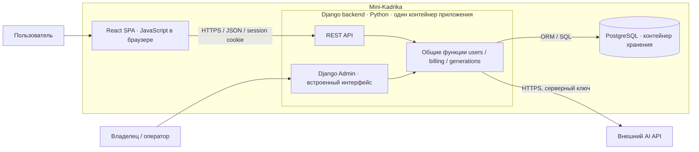

# Архитектура: краткая arc42

Проект будущего MVP, не описание готового backend. Разделы следуют [arc42](https://arc42.org/overview/); текущее состояние описано в [обзоре прототипа](../prototype/overview.md).

## 1. Цели

Создавать стихотворения, учитывать внутренний баланс и давать оператору контроль над пользователями и операциями. [Требования и вопросы](../product/requirements.md).

## 2. Ограничения

Backend — Python. Предлагаемый MVP: Django, PostgreSQL, один AI-провайдер. Срок тестового — сутки; конкретный объём и оценка будут определены после обратной связи. Фоновые задачи и реальные платежи не входят в текущий вариант.

## 3. Контекст

Пользователь работает через React, оператор — через Django Admin. Backend хранит данные в PostgreSQL и обращается к внешнему OpenAI-совместимому API. Ключ AI доступен только серверу.

## 4. Решение

Один Django-проект и REST API через DRF. Админка используется для создания/блокировки пользователей, начислений и простых итогов по фильтрам. Генерация синхронная ради быстрого первого запуска; очередь — отдельный будущий этап.

## 5. Структура

Три модуля backend: `users` — доступ, `billing` — кошельки и операции, `generations` — AI и история. API и Admin вызывают общие функции учёта. [Модель БД](data-model.md); [текущее устройство frontend](../prototype/frontend-architecture.md).

## 6. Выполнение

1. Сервер проверяет пользователя, параметры и requestId.
2. В короткой транзакции проверяет баланс, создаёт генерацию и списание.
3. Вне транзакции вызывает AI и ждёт ответ.
4. Сохраняет результат либо ошибку с однократным возвратом; отвечает браузеру.

Начисление в админке также атомарно меняет кошелёк и создаёт операцию с автором и основанием. Повторы не создают нового денежного эффекта. [Правила и сбои](../product/business-rules.md).

## 7. Развёртывание

Предлагаются Docker Compose с Django и PostgreSQL, постоянный том БД и HTTPS средствами хостинга. Миграции, создание оператора и проверка восстановления копии войдут в инструкцию backend. Пока готов только [запуск frontend](../../README.md#как-запустить).

## 8. Общие правила

Сессии и права Django, серверная валидация, транзакции, идентификаторы запросов и неизменяемый журнал. [Бизнес-правила](../product/business-rules.md) и [предварительный API](api-contracts.md) содержат детали. Токены AI учитываются отдельно от внутренних единиц.

## 9. Почему так

Django выбран ради встроенных аккаунтов и админки; отдельный административный frontend не нужен. PostgreSQL — для согласованного учёта при одновременных запросах. Синхронный AI сокращает инфраструктуру, но занимает обработчик запроса до ответа или таймаута.

## 10. Качество

Приоритеты: корректный баланс, изоляция пользователей и воспроизводимый запуск. Конкурентность проверяется на PostgreSQL; локальные тесты её не доказывают. Нагрузка и допустимое ожидание пока не согласованы. [Критерии и результаты](../testing/acceptance-criteria.md).

## 11. Риски и оставшиеся работы

Прототип не проверяет реальный AI, серверную безопасность и транзакции. При падении синхронного запроса возможна зависшая запись: нужна служебная компенсация, автоматическое продолжение не обещается.

При подключении Django потребуется добавить CSRF, убрать sessionId из JSON, обработать истечение сессии и сохранять ключ незавершённого запроса для восстановления. Одного переключения `local` → `http` недостаточно. Провайдер, таймауты и стоимость внешних вызовов требуют согласования. [Следующие шаги](../product/next-steps.md).

## 12. Термины

- **Внутренние единицы** — неделимый баланс сервиса, не деньги и не токены AI.
- **CREDIT / DEBIT / REFUND** — начисление / списание / возврат.
- **Атомарность** — связанные изменения фиксируются вместе либо откатываются.
- **Идемпотентность** — повтор одного запроса не создаёт повторного эффекта.
- **Usage** — сообщённый провайдером расход токенов.
