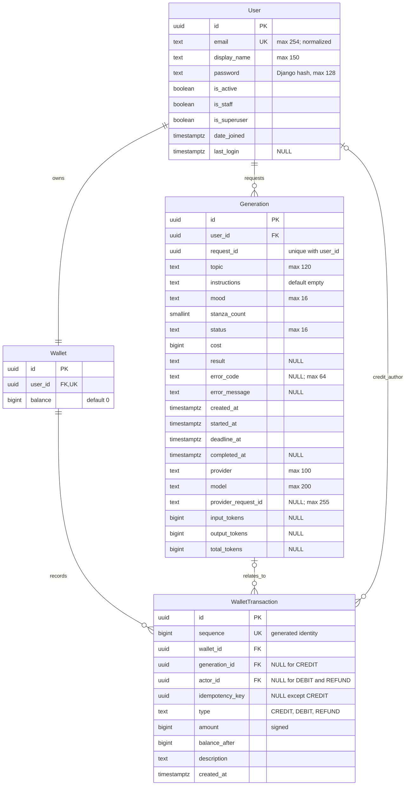

# Mini-Kadrika — предварительная модель данных

**Статус: Draft · 25.11.2026.** To-Be PostgreSQL; модели/миграции ещё не реализованы. Источник As-Is — [types.ts](../../src/api/types.ts), [local.ts](../../src/api/local.ts), [storage.ts](../../src/api/storage.ts). Правила операций — [business-rules.md](../product/business-rules.md), API-проекции — [architecture.md](architecture.md).

## ERD

Типы ниже — PostgreSQL; `timestamptz` хранит момент времени, UI явно выбирает часовой пояс. PK/FK/UK — первичный/внешний/уникальный ключ. Составные и частичные UNIQUE описаны после схемы: их нельзя читать как уникальность каждого поля отдельно.

Все строковые поля доменной схемы используют `text`. Указанные в ERD значения `max` — отдельные ограничения `CHECK`, а не параметры типа; они сохраняют предварительные лимиты данных.

ERD допускает 0..N операций у генерации для читаемости; ограничения ниже сужают их до одного DEBIT и не более одного REFUND. У каждого пользовательского аккаунта ровно один Wallet по прикладному правилу; FK+UNIQUE сами по себе гарантируют лишь «не более одного».

## Назначение и отличия от frontend

| Сущность | Назначение / решение Draft |
| --- | --- |
| `User` | Минимальный наследник `AbstractUser`: UUID PK, уникальный нормализованный email как `USERNAME_FIELD`, без отдельного username, `display_name`. Пароли, active/staff/superuser, группы, permissions, sessions остаются стандартными Django. Создание через адаптированную форму/manager атомарно создаёт Wallet. |
| `Wallet` | Единственный кошелёк пользователя; `balance` — материализованная сумма неизменяемых операций, исходно 0. Не доступен для прямого редактирования через API/Admin. |
| `Generation` | Принятый платный запрос с ценой на момент принятия, параметрами, состоянием, результатом/ошибкой, метаданными AI и сроком завершения. Невалидный/неоплаченный запрос здесь не сохраняется. |
| `WalletTransaction` | Неизменяемое движение единиц. `amount` знаковый, `balance_after` — остаток после операции, `actor_id` — автор CREDIT. `sequence` даёт однозначный порядок для сверки при одинаковых timestamps; выделять при INSERT после блокировки Wallet. Пропуски после rollback допустимы. |

Нет отдельной таблицы роли, биллинговой сессии, AI-задания или начисления: Django permissions, `Generation` и `WalletTransaction` достаточны. Стандартные Django session/group/permission/admin log таблицы не показаны на доменной ERD. Минимальное расширение User следует штатному механизму Django и задаётся до первых миграций ([документация](https://docs.djangoproject.com/en/5.2/topics/auth/customizing/#using-a-custom-user-model-when-starting-a-project)).

При реализации Django явно обеспечить SQL-тип `text` для строковых полей пользовательской модели, включая унаследованный `password`; сохранить стандартное хеширование и проверку паролей, валидацию email и соответствующие поля форм Admin. Проверять итоговый SQL миграций: одного изменения ERD недостаточно. Ограничение `password` относится к сохранённому представлению хеша, а не к длине вводимого пароля.

В отличие от DTO `WalletTransaction.userId` не хранится вторично: выводится из Wallet. `Generation.user_id` нужен для изоляции и `(user_id, request_id)`. `AuthSession` не копируется в бизнес-таблицу; настоящая session cookie не возвращается в JSON. `DemoState`, credentials из демо, начальные примеры, `PENDING` и demo controls не мигрируются в рабочую БД.

`provider` и `model` фиксируются из серверной конфигурации до внешнего вызова (даже при тайм-ауте известно, куда обращались); если провайдер вернул фактическую модель, сохраняется её идентификатор. `provider_request_id` — корреляция, не обещание дедупликации на стороне провайдера. `deadline_at` нужен служебному восстановлению. Публичная ошибка очищается от секретов и внутренних деталей.

## Nullable и значения по умолчанию

Все поля NOT NULL, кроме явно отмеченных в ERD. `instructions=''` означает отсутствие пожеланий, а не NULL. `last_login` NULL до первого входа. `provider_request_id` и каждое поле usage NULL при отсутствии соответствующих данных; частично известный usage допустим. Нулевые токены сохраняются только если провайдер сообщил 0.

| Состояние / тип | Условия nullable |
| --- | --- |
| `PROCESSING` | `result`, `error_code`, `error_message`, `completed_at` NULL. `started_at` заполнен при принятии, это начало обработки backend, не доказательство отправки AI. |
| `COMPLETED` | Непустой `result` и `completed_at`; обе ошибки NULL. |
| `FAILED` | `result` NULL; непустые `error_code`, `error_message`, `completed_at`. |
| `CREDIT` | `generation_id` NULL; `actor_id` и `idempotency_key` NOT NULL. |
| `DEBIT` / `REFUND` | `generation_id` NOT NULL; `actor_id`, `idempotency_key` NULL. Их ключ — связь с генерацией и типом, а причина восстановления фиксируется в Generation и служебном логе. |

## Ограничения БД

`M = 9007199254740991` — максимальное безопасное целое JavaScript. Денежные поля — BIGINT, без float, дробей и валютной конвертации. Максимальный операционный лимит может быть уменьшен после Q-03.

Для строковых полей верхние границы задаются отдельными именованными CHECK вида `CHECK(char_length(field) <= N)`; для nullable-полей — `CHECK(field IS NULL OR char_length(field) <= N)`. `char_length` считает символы PostgreSQL; дополнительная валидация UTF-16 для пользовательского ввода определена в BR-003.

| Таблица | Поля и верхние границы CHECK |
| --- | --- |
| User | `email` — 254, `display_name` — 150, `password` — 128. |
| Generation | `topic` — 120, `instructions` — 1000, `mood` и `status` — 16, `error_code` — 64, `provider` — 100, `model` — 200, `provider_request_id` — 255. |

Ограничение длины `topic` проверяет сохранённую строку целиком; проверка непустого `btrim(topic)` ниже действует дополнительно. Допустимые значения `WalletTransaction.type` ограничены перечислением в CHECK ниже. Остальные поля `text` не имеют объявленного верхнего предела длины в текущем Draft.

| Таблица | CHECK / UNIQUE / FK |
| --- | --- |
| User | `UNIQUE(email)` плюс `UNIQUE(lower(email))`; приложение приводит email к lower/trim, CHECK непустого нормализованного email. `display_name` непустой. Формат email валидируется Django. |
| Wallet | `UNIQUE(user_id)`, FK User; `CHECK(0 <= balance AND balance <= M)`. |
| Generation | FK User; `UNIQUE(user_id, request_id)`; `CHECK(1 <= cost AND cost <= M)`, `CHECK(stanza_count BETWEEN 1 AND 4)`, `CHECK(char_length(btrim(topic)) BETWEEN 1 AND 120)`, `CHECK(char_length(instructions) <= 1000)`. |
| Generation | `mood IN ('neutral','romantic','cheerful','sad','philosophical','dark')`; `status IN ('PROCESSING','COMPLETED','FAILED')`; CHECK состояния и NULL-полей по таблице выше. `started_at >= created_at`, `deadline_at > started_at`, `completed_at IS NULL OR completed_at >= started_at`. |
| Generation usage | Каждое значение `IS NULL OR >= 0`. Не вводить равенство total = input + output до проверки семантики провайдера: хранится нормализованное сообщённое значение, неизвестное не вычисляется самовольно. |
| WalletTransaction | FK Wallet, Generation, User(actor); `UNIQUE(sequence)`; `CHECK(-M <= amount AND amount <= M AND amount <> 0)`, `CHECK(0 <= balance_after AND balance_after <= M)`, непустой `description`. |
| WalletTransaction | CHECK: либо CREDIT и amount > 0 с полями по таблице выше, либо DEBIT и amount < 0, либо REFUND и amount > 0. Явные IS NULL / IS NOT NULL исключают обход через SQL NULL. |
| WalletTransaction | Частичный `UNIQUE(generation_id, type) WHERE generation_id IS NOT NULL` исключает повторные DEBIT/REFUND. Частичный `UNIQUE(actor_id, idempotency_key) WHERE type='CREDIT'` исключает повтор формы оператора, включая другой кошелёк. |

Предварительно mood остаётся ограниченным значением, отдельный справочник не нужен. Цена в CHECK не равна 10 намеренно: запись хранит исторический снимок, а текущая цена определяется конфигурацией сервера (BR-004).

Межстрочные условия — совпадение владельца Generation и Wallet, `DEBIT.amount=-Generation.cost`, `REFUND.amount=Generation.cost`, наличие списания до возврата, равенство balance сумме журнала — проверяет общая сервисная логика в транзакции с блокировками. Обычный CHECK не проверяет другие строки/таблицы ([ограничения PostgreSQL](https://www.postgresql.org/docs/16/ddl-constraints.html)). Их нельзя выдавать за гарантию одного `CheckConstraint`. Прямые обходные записи через API/Admin запрещены; интеграционные тесты проверяют все пути. Доступ DBA вне модели доверия приложения.

Для неизменяемости журнала runtime-роль БД получает SELECT/INSERT, без UPDATE/DELETE/TRUNCATE на таблицу операций; миграции выполняются отдельной ролью владельца схемы. В Admin операции только для чтения, денежная запись создаётся сервисом; `save()`-переопределение само по себе не защищает bulk SQL. Это права существующей PostgreSQL, не новая инфраструктура. Механизм корректировок до Q-03 не реализуется; историю не переписывают.

## Индексы

Помимо PK/UNIQUE и индексов FK Django предлагаются:

| Индекс | Запрос |
| --- | --- |
| `Generation(user_id, created_at DESC, id)` | Личная история; детерминированное разрешение равных дат. |
| `Generation(status, created_at)` | Admin: статус/период. |
| `Generation(created_at)` | Admin: отчёт за период по всем пользователям. |
| `Generation(deadline_at) WHERE status='PROCESSING'` | Выбор просроченных записей для восстановления. |
| `WalletTransaction(wallet_id, sequence DESC)` | Журнал и сверка последовательных остатков. |
| `WalletTransaction(created_at, type)` | Итоги Admin за период и тип операции. |

Индекс уникального `(user_id, request_id)` обслуживает поиск запроса; дополнительный индекс только `request_id` не нужен. Не добавлять отдельные индексы, уже покрытые PK/UNIQUE. При неизвестных объёмах это исходный набор, который проверяется на реальных запросах, а не обещание производительности.

## Идемпотентность, история и удаление

Ключ генерации — UUID клиента в пределах пользователя; хранится вместе с записью, отдельно таблица ключей не нужна. Сравниваются сохранённые нормализованные `topic`, `instructions`, `mood`, `stanza_count`, а не хеш без исходного payload. Изменение текущей цены не делает повтор новым запросом. Непринятый запрос ключ не резервирует. Ключ начисления — UUID формы и автор; сравниваются кошелёк, сумма и нормализованное основание. Конфликт UNIQUE из конкурирующего INSERT обрабатывается после rollback соответствующего atomic-блока: перечитать запись, вернуть прежнюю или конфликт, не продолжать в сломанной транзакции.

Денежная история сохраняется целиком с момента нулевого кошелька. Для каждого Wallet порядок `sequence` даёт `balance_after[n] = balance_after[n-1] + amount[n]`; первый остаток равен первой сумме. Дата фиксируется сервером при операции, sequence не используется как дата отчёта. Сверка проверяет конечный баланс, каждый промежуточный остаток и связи с Generation (BR-009).

Все доменные FK — Django `PROTECT` с ограничением целостности в БД; каскадного удаления финансовой истории нет. Удаление User, Wallet, связанной Generation или автора начисления при наличии ссылок запрещено; штатное действие — `is_active=false`. Пока Q-07 открыт, удаления истории и очистки ключей нет, незавершённые и терминальные Generation не удаляются через интерфейс. Если потребуется удаление/обезличивание контента, отдельно определить сохранение минимального финансового следа и ключа, чтобы старый запрос не получил повторное списание. Это проектное ограничение, не установленный заказчиком бессрочный срок хранения.

Защита от отрицательного баланса обеспечивается CHECK плюс блокировкой Wallet и атомарной записью журнала. От двойного списания/возврата — уникальные связи, статус и общий сервис. Для безопасного возврата при верхней границе M начисление проверяет также `balance + сумма cost всех PROCESSING + новое начисление <= M`; все изменения этого набора выполняются под блокировкой того же Wallet (BR-004). Одного CHECK balance для этого недостаточно.
