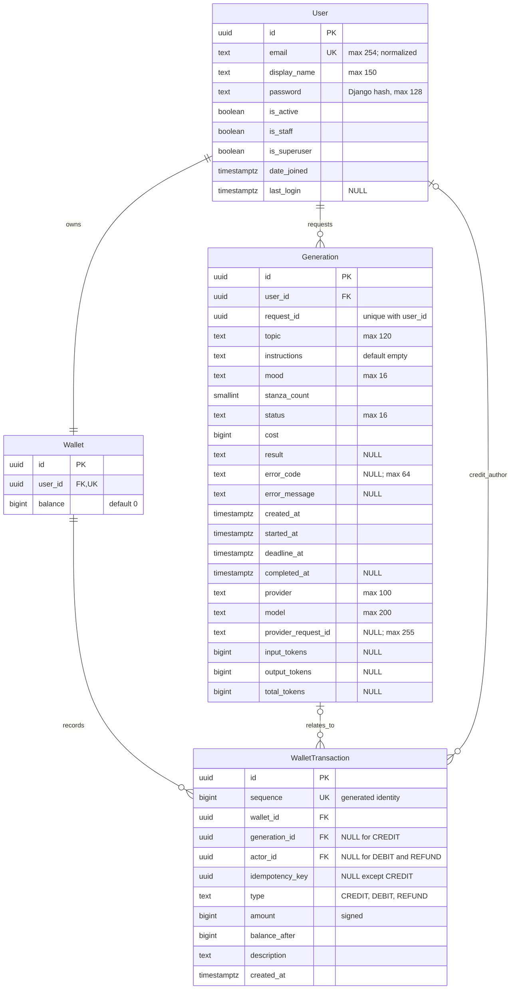

# Предварительная модель данных

Проект PostgreSQL для будущего backend. Миграций пока нет. Четыре сущности: пользователь, кошелёк, генерация и операция.

## Основные правила

- User — расширение Django AbstractUser с UUID и уникальным нормализованным email для входа. `is_active`, `is_staff`, `is_superuser` сохраняются для блокировки и Django Admin; отдельной модели Admin нет.
- У пользователя один Wallet. Создание аккаунта и кошелька атомарно, начальный баланс 0.
- Generation хранит параметры, результат/ошибку, цену, даты, провайдера, модель и расход токенов. Неизвестный usage — NULL; цена от токенов пока не зависит.
- WalletTransaction хранит знаковую сумму, остаток после операции, связь с генерацией либо автора начисления. `sequence` задаёт порядок журнала при одинаковых датах.
- Денежные поля — BIGINT, но ограничиваются безопасным целым JavaScript. Масштаб 1:1: 10 в базе означает 10 неделимых единиц. Возможная дробность — Q-09.
- Уникальны email, кошелёк пользователя, пара (user_id, request_id), списание/возврат каждой генерации и ключ начисления в пределах автора.
- Баланс неотрицателен; CREDIT/REFUND положительны, DEBIT отрицателен. Сумма журнала совпадает с балансом. Межтабличные проверки выполняются общей логикой внутри транзакции.
- У COMPLETED есть результат и дата завершения; у FAILED — причина, дата и однократный возврат. PROCESSING ещё не имеет окончательного результата.
- История не удаляется через интерфейс; аккаунт можно отключить. Сроки хранения и обезличивание требуют Q-07.

Стандартные таблицы сессий, разрешений и журнала Django Admin на схеме не показаны. Демо-credentials и LocalStorage не переносятся в рабочую БД. Индексы истории и фильтров, конкретные CHECK и длины полей уточним перед миграциями; отметки в ERD предварительные.

[Бизнес-правила](../product/business-rules.md) · [Вопросы](../product/requirements.md#вопросы-для-согласования)
