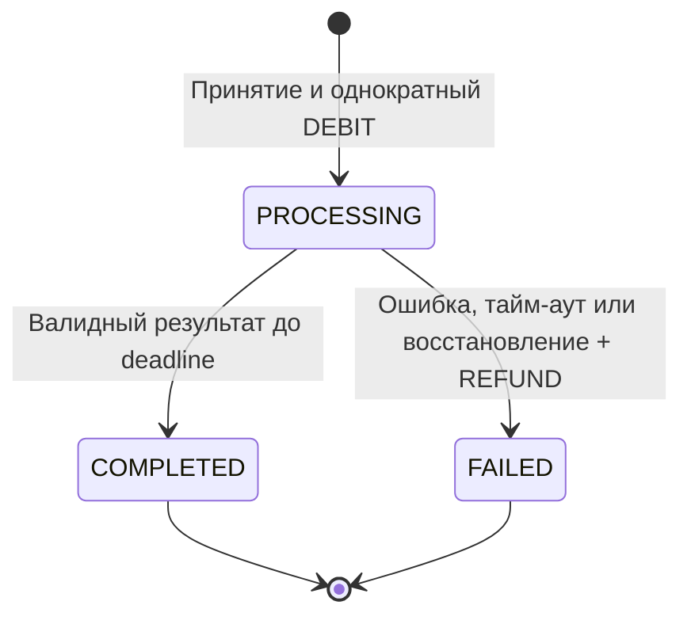

# Mini-Kadrika — бизнес-правила

**Статус: Draft · 25.11.2026.** Ниже правила предлагаемого продукта, независимые от UI. Цена, возвраты и эксплуатационные пороги требуют согласования по [Q-03–Q-05](requirements.md). Демонстрационные реализации — [local.ts](../../src/api/local.ts), [summary.ts](../../src/shared/utils/summary.ts); их возможности не являются гарантиями backend.

## Доступ и финансовая модель

| ID | Правило To-Be |
| --- | --- |
| BR-001 | Только активный пользователь получает свои данные и запускает генерацию. Владелец определяется сессией, чужой ID даёт 404. Staff-доступ и конкретные permissions нужны для Admin; обычная пользовательская API-сессия не даёт операторских возможностей. Деактивация запрещает следующие защищённые запросы; уже принятый запрос завершается/компенсируется по общим правилам. |
| BR-002 | Создание пользователя и единственного Wallet с balance=0 атомарно. Начальные единицы появляются только отдельным положительным CREDIT оператора с автором и основанием. Демо-балансы 130/10/0 не переносятся в продукт. |
| BR-003 | `requestId` — UUID. Тема после trim обязательна, до 120 символов; пожелания необязательны, исходная строка до 1000, сохраняется trim; настроение одно из шести значений [модели](../architecture/data-model.md), число четверостиший — целое 1–4. Сервер проверяет типы до обработки. Точный подсчёт Unicode длины нужно унифицировать с браузером: предлагается считать UTF-16 code units как текущий JS; эмодзи проверяются отдельно. SQL CHECK остаётся дополнительной, а не полной валидацией длины. |
| BR-004 | Внутренние единицы неделимы; дробные суммы отклоняются без округления. Масштаб хранения и отображения — 1:1. Цена предварительно фиксирована: 10 целых единиц на генерацию, независимо от параметров/токенов. Возможная дробность вынесена в Q-09 и пока не реализуется. Сервер фиксирует cost в Generation при принятии. Quote — снимок без резерва; реальная проверка идёт под блокировкой Wallet. Суммы/баланс в пределах M из [модели](../architecture/data-model.md); CREDIT также резервирует числовой запас для всех возможных REFUND по PROCESSING: balance + сумма их cost + начисление <= M. |
| BR-005 | При принятии валидного нового запроса одновременно создать PROCESSING, DEBIT=-cost и уменьшить Wallet.balance. Не хватает средств — отклонить целиком, без Generation, DEBIT и AI-вызова. Дедупликация принятого ключа проверяется раньше доступности средств для нового запроса. |
| BR-006 | После технической ошибки, тайм-аута, пустого/неразбираемого ответа либо служебного восстановления выполнить один REFUND=cost и FAILED в одной транзакции. Возврат возможен только для PROCESSING с соответствующим DEBIT. Неуспех означает полный возврат, частичного возврата нет. Отказ провайдера без стихотворения предлагается считать неуспехом; спор о художественном качестве требует Q-04. |
| BR-007 | CREDIT — положительная целая сумма, непустое основание, активный staff с разрешением начисления; целевой аккаунт должен существовать (начисление не активирует его). Автор и время берутся сервером. Прямое изменение баланса и отрицательный CREDIT запрещены. Исправление ошибочного начисления требует отдельного согласованного правила, не удаления старой операции. |
| BR-008 | Идемпотентность начисления: ключ `(actor_id, idempotency_key)`; повтор с теми же Wallet/amount/description возвращает прежнюю операцию, иной payload — конфликт. CSRF token не является этим ключом. Повтор после перезагрузки формы должен сохранять прежний ключ незавершённой отправки. |
| BR-009 | Баланс равен сумме всех signed amount с нулевого начала. Он и журнал изменяются атомарно. `balance_after` — остаток непосредственно после записи. Сверка под блокировкой Wallet сравнивает balance, сумму и цепочку остатков по sequence, DEBIT/REFUND и cost. При расхождении — сигнал оператору, без молчаливого переписывания журнала или автоматического «исправления» balance. |
| BR-010 | Общий расход = сумма модулей DEBIT минус сумма REFUND, CREDIT не считается расходом. Число созданных стихов = число COMPLETED. За период движения учитываются по created_at самой операции; возврат в другом периоде относится к нему, поэтому чистый расход периода может быть отрицательным. Текущий баланс не ограничивается фильтром периода. |
| BR-011 | В Admin итоги строятся на тех же фильтрах, что список: запросы по дате создания, их текущие статусы, уникальные пользователи и суммы известных input/output/total_tokens; неизвестные значения считаются отдельно для каждого поля. Пустая выборка — 0 запросов/сумм; неизвестный usage не подменяется нулём. Временной диапазон полуоткрытый `[from,to)`, отображаемый часовой пояс согласуется по Q-08. Usage не влияет на цену. |

Финансовые инварианты BR-004–BR-009 для **зафиксированного состояния**:

- `0 <= Wallet.balance <= M`, операции неизменяемы, сумма журнала равна балансу.
- У принятой Generation ровно один DEBIT на `-cost` и максимум один REFUND на `+cost`; оба относятся к её владельцу.
- У PROCESSING/COMPLETED нет REFUND; у FAILED ровно один REFUND и чистый расход этой генерации равен 0.
- Повтор ключа не создаёт новый денежный эффект. Переход в FAILED и возврат либо фиксируются вместе, либо оба откатываются.
- Общий расход за всё время неотрицателен и включает cost незавершённых PROCESSING; это уже списанные единицы, а не обещание готового результата.

## BR-012 — границы транзакций и блокировки

Общий порядок блокировок: **Wallet → Generation**; все пути, включая успешное завершение, восстановление и сверку, соблюдают его. Владельца Generation можно предварительно прочитать, но изменяемое состояние повторно читается после блокировок. Внутри `transaction.atomic()` использовать `select_for_update()`; стандартного PostgreSQL READ COMMITTED достаточно при соблюдении этих протоколов и UNIQUE. Блокировки действуют до конца транзакции, конкурентность проверяется отдельными соединениями, а не одним обычным Django TestCase ([документация](https://docs.djangoproject.com/en/5.2/ref/models/querysets/#select-for-update)).

| Атомарная операция | Записи / блокировки | Проверки и действия одной транзакции | COMMIT / ROLLBACK |
| --- | --- | --- | --- |
| Запуск генерации | Lock Wallet; при найденном ключе — Generation. Новая Generation, Wallet, DEBIT. | Повторно найти `(user_id,request_id)`. При совпадении payload вернуть запись без изменения; при новом ключе проверить средства, зафиксировать cost, created/start/deadline, PROCESSING, DEBIT и balance. | COMMIT принятия до AI; валидация/конфликт/недостаток/ошибка записи — никаких частичных изменений. |
| Успешное завершение | Lock Wallet → Generation; меняется Generation. | Ещё PROCESSING и срок не истёк; сохранить текст, модель/usage, COMPLETED, completed_at. Денежных изменений нет. | COMMIT результата; ошибка сохранения — ROLLBACK, статус остаётся PROCESSING. Если уже terminal, вернуть существующее состояние; если просрочена, использовать операцию неудачи. |
| Неудачное завершение с возвратом | Lock Wallet → Generation; Wallet, Generation, REFUND. | Ещё PROCESSING, DEBIT существует и соответствует владельцу/cost; возврата нет. Создать REFUND, увеличить balance, FAILED с причиной/временем и доступным usage. | COMMIT всех изменений; при ошибке ROLLBACK всех. Уже FAILED — no-op; COMPLETED не компенсируется. Неконсистентная история — ошибка и ручное расследование. |
| Начисление | Lock целевого Wallet; Wallet и CREDIT. | Проверить права/тип/сумму/основание, найти ключ, сверить payload, проверить числовой запас BR-004, создать CREDIT и balance_after, изменить balance. | COMMIT операции или чтения повтора; конфликт/ошибка — ROLLBACK. Уникальность ключа защищает также запросы к разным кошелькам. |
| Восстановление зависшей генерации | Отдельная транзакция на запись: Lock Wallet → Generation. | Повторно проверить PROCESSING и deadline_at <= время БД; применить ту же функцию неудачи с `RECOVERY_TIMEOUT`, REFUND, balance и completed_at. | COMMIT компенсации; уже terminal — no-op; ещё не просрочена — пропустить; при ошибке ROLLBACK, запись остаётся для повторной проверки. |

При UNIQUE-конфликте не ловить исключение внутри неисправного atomic и не продолжать SQL: выйти с rollback, затем перечитать сохранённую запись и сравнить payload. При неопределённом исходе COMMIT (потеря соединения с БД) также сначала перечитать состояние; запрет повторного эффекта обеспечивают ключи и статусы. AI вызывается **только** обработчиком, который создал новую Generation и подтвердил COMMIT принятия. Если исход принятия неизвестен, не отправлять AI наугад: запись при необходимости завершит восстановление.

Ни HTTP-вызов AI, ни ожидание ответа, ни повтор подключения к нему не входят в транзакцию PostgreSQL. Не использовать общую транзакцию на весь request. Если БД недоступна, нельзя обещать клиенту состоявшийся возврат.

## BR-013 — жизненный цикл генерации

| Из → в | Условие | Побочный эффект / запреты |
| --- | --- | --- |
| Нет записи → PROCESSING | Новый валидный ключ, хватает баланса | Списание и создание атомарны. Ошибка до приёма не создаёт FAILED. |
| PROCESSING → COMPLETED | Непустой пригодный ответ, терминальная запись ещё не установлена, deadline не достигнут | Сохранение результата и usage; повторного списания нет. |
| PROCESSING → FAILED | Техническая ошибка, истёк deadline или служебное восстановление | Единственный возврат в той же транзакции. |
| Любой terminal → тот же terminal | Повтор чтения/финализации | No-op; возвращается ранее сохранённое состояние. |

Запрещены COMPLETED → FAILED, FAILED → COMPLETED, любой terminal → PROCESSING и изменение результата терминальной записи. Повторить генерацию после FAILED можно только новой пользовательской командой с новым ключом и новым списанием. `PENDING` есть в frontend для прежнего async-контракта, но To-Be без очереди его не создаёт. `CANCELLED` и отдельные статусы refund не нужны: пользовательской отмены нет, компенсация атомарна с FAILED.

## BR-014 — идемпотентность генерации

Ключ `(user_id,request_id)` действует весь срок хранения Generation. Для повтора сравниваются нормализованные параметры BR-003. Одинаковый payload возвращает текущую запись (включая PROCESSING/FAILED), без повторного AI и списания; изменённый — 409 CONFLICT. Разные пользователи могут использовать одинаковый UUID. После отклонения до приёма запись/ключ отсутствует, повтор с тем же ключом может быть принят при устранении причины.

Клиент сохраняет ключ и параметры до терминального результата. После сетевой неопределённости читает запись по ключу. 404 ещё не доказывает, что прежний запрос не придёт позже: повтор отправляется с **тем же** ключом. Проверка существующего ключа не зависит от текущего quote или нового баланса. Срок удаления ключей — Q-07, сокращать его отдельно от истории нельзя.

## BR-015 — конкурентные ситуации

| Ситуация | Ожидаемое поведение |
| --- | --- |
| Баланс 10, два разных запроса стоимостью 10 | Первый держит lock Wallet и списывает; второй после lock видит 0 и отклоняется. Один AI-вызов, один DEBIT. |
| Два запроса с одним ключом | После lock второй видит принятую запись; возвращает её без AI. UNIQUE — дополнительная защита, не основание для 500. |
| Повторная/одновременная компенсация | Только первый перевод PROCESSING → FAILED добавляет REFUND; остальные no-op. |
| Одновременное начисление и списание | Сериализация по Wallet. Если сначала DEBIT при недостатке — он отклоняется; если сначала CREDIT и суммы хватает — DEBIT допустим. В обоих случаях журнал и остаток согласованы. |
| Завершение и «отмена» | Публичной отмены нет. Для служебного закрытия просроченной записи и успешного ответа действует тот же lock и проверка deadline; только один terminal. Успех до deadline побеждает последующую компенсацию; после deadline успех уже недопустим. |
| Две формы начисления с одним ключом | BR-008, в том числе при разных целевых кошельках: уникальность `(actor,key)`, конфликтующий payload не создаёт вторую операцию. |

## Сбои и восстановление

| ID | Ситуация и правило |
| --- | --- |
| BR-016 | AI вернул ошибку, отказ, неразбираемый или пустой текст — финализировать FAILED/REFUND. Точные контентные критерии обсуждаются в Q-04; несоответствие вкусу не даёт автоматический возврат. Автоматических повторов AI нет, в том числе скрытых retries HTTP SDK. |
| BR-017 | Задать конечный суммарный тайм-аут AI и `deadline_at` при принятии. Предложение: `T_AI + запас записи < T_deadline < T_worker/proxy`; значения согласовать и проверить. Решение о сроке принимает БД при финализации после получения блокировок. Поздний ответ не переоткрывает terminal и не списывает вновь; если запись ещё PROCESSING, но deadline истёк — FAILED/REFUND. Недоступные после падения usage не выдумываются. |
| BR-018 | Обрыв связи с frontend не является доказательством сбоя AI и не запускает возврат сам по себе. Backend по возможности заканчивает обработку; при убийстве процесса запись восстанавливается по BR-019. Пользователь читает состояние по ключу и повторяет только его, а не создаёт автоматически новую генерацию. |
| BR-019 | После падения backend после списания management command `recover_generations` выбирает просроченные PROCESSING и по одной завершает их через общую функцию FAILED/REFUND. Повторный запуск безопасен, параллельные запуски сериализуются; свежие записи пропускаются. Команда не отправляет AI заново и пишет ID/причину/исход в лог. Запуск вручную после сбоя и при обнаружении просрочек; ответственный и срок реакции — Q-05. Автовосстановление без оператора не обещается. |
| BR-020 | Ошибка сохранения результата откатывает финализацию, но не ранее подтверждённый DEBIT. После восстановления связи с БД перечитать Generation: COMPLETED сохранить как есть; FAILED не менять; PROCESSING можно завершить FAILED с `RESULT_SAVE_ERROR` и REFUND. Если БД недоступна/процесс погиб, остаётся BR-019. При неопределённом исходе COMMIT нельзя сначала компенсировать без чтения статуса. |

Локальный биллинг гарантирует атомарность и однократный денежный эффект для принятого ключа в рамках описанных серверных путей. Внешний AI не участвует в транзакции: после отправки и падения неизвестно, был ли вызов исполнен/оплачен. Exactly-once внешнего запроса не обещается. Возможен расход у провайдера без результата для пользователя и с возвращёнными внутренними единицами. Если AI позже отдаст успешный ответ уже компенсированной генерации, его текст не сохраняется как успешный результат, а событие отмечается в техническом логе без повторного биллинга.

Восстановление local API при загрузке старых PENDING/PROCESSING не проверяет возраст и не связано с живым AI. Переносить этот алгоритм буквально в многопроцессный Django нельзя: новый web-процесс не должен отменять работу другого процесса.
